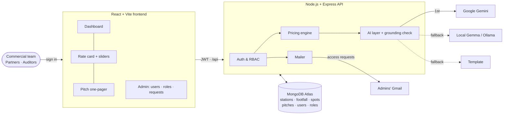
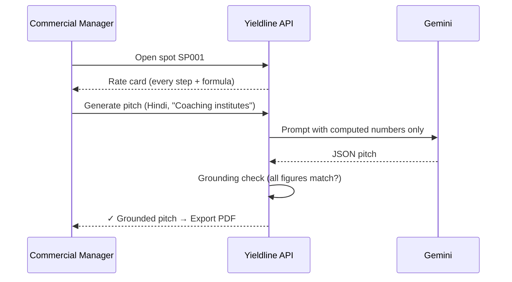

<div align="center">


### Every footstep, priced.

**Footfall-to-revenue intelligence for Gujarat Metro.** Turn station ridership into a defensible rate card for every vacant ad panel, kiosk and shop, and a ready-to-send AI sales pitch for each one.

<br/>


[Demo](#-demo) · [Features](#-features) · [How pricing works](#-how-the-price-is-calculated) · [Architecture](#-architecture) · [Run it](#-run-it-locally) · [API](#-api) · [Data](#-data--sources)

</div>

---

## 🚇 The problem

Station ad panels and shops sit **empty** because the metro can't prove what they're worth. The commercial team has no credible answer to three questions every advertiser asks:

| Question | Without Yieldline | With Yieldline |
|---|---|---|
| How many people pass this spot, and when? | "A lot, especially in the morning" | **6,04,313 impressions/month**, peak **8–10 AM, 5–9 PM** |
| Who are they? | Guesswork | **42% aged 26–40**: commuters, travellers, traders |
| Why does spot A cost more than spot B? | Negotiation | **Every rupee traced** to footfall × exposure × CPM |

Without that evidence, pricing is guesswork, deals stall and **non-fare revenue is lost**.

## 🎬 Demo

> 📹 **Demo video:** _add your recording here_. On GitHub, edit this README and drag an `.mp4` file in; it embeds as a video player.

**90-second walkthrough**

1. **Sign in.** Role-based access: what you see depends on who you are.
2. **Dashboard.** Untapped monthly revenue across the network, stations, every vacant spot with price and tier.
3. **Rate card.** Open a Kalupur concourse panel: the price is built step by step. Drag the CPM slider and every number updates live.
4. **AI pitch.** Gemini writes a one-pager aimed at the best-fit advertiser, in English, हिंदी or ગુજરાતી. The ✓ **Grounded** badge proves every figure matches the rate card.
5. **Export PDF.** A one-page A4 sales sheet, ready to send.

## ✨ Features

<table>
<tr>
<td width="50%" valign="top">

### 📊 Revenue dashboard
- Untapped monthly & annual revenue, occupancy, PPP split
- Station cards with daily footfall, peak windows, vacant value
- Filter spots by station, type, tier, status, search

### 🧮 Transparent pricing engine
- **Ad panels:** impressions × CPM × tier × audience
- **Kiosks & shops:** shoppers × ticket × rent share, with floor
- Every step shown with its formula, nothing hidden
- Live **what-if sliders**: CPM, rent share, conversion, audience
- **Match-day mode** for Motera Stadium event days
- Relative tiers: Premium / Standard / Value

</td>
<td width="50%" valign="top">

### 🤖 Grounded AI sales pitches
- Google **Gemini** writes audience profile, top 3 buyer categories, headline, reasons, CTA
- **Grounding check:** every number in the AI output is verified against the rate card
- Aim the pitch at any category, regenerate in one click
- **3 languages** + Gujarati summary line
- Fallback chain: Gemini → local Gemma (Ollama) → template. The demo never breaks.
- Pitches cached in MongoDB, invalidated when the price changes

### 🔐 Role-based access
- Sign-in only, **no public sign-up**; outsiders **apply for access**
- Requests emailed to **every admin's Gmail**
- 6 default roles, custom roles with **permission checkboxes**
- Re-enter your password to grant admin rights

</td>
</tr>
</table>

**Also:** light / dark / black-and-white themes · one-page PDF export · CSV rate card · real AFC data import · in-memory fallback if Atlas is unreachable.

## 🧮 How the price is calculated

```text
AD PANELS (impressions model)
  hourly_impressions  = footfall_h × zone_exposure × visibility_score
  monthly_impressions = 22 × weekday_daily + 8 × weekend_daily  (+ match-day extra)
  monthly_price       = monthly_impressions / 1000 × base_CPM × tier_multiplier × audience_multiplier

KIOSKS & SHOPS (revenue-share model)
  daily_shoppers = daily_footfall × capture_rate(zone) × conversion × visibility
  monthly_sales  = daily_shoppers × avg_ticket × 30
  monthly_rent   = max(min_rent, monthly_sales × rent_share)
```

| Assumption | Default | Editable |
|---|---|:---:|
| Base CPM | ₹40 / 1,000 impressions | ✅ |
| Zone exposure | Concourse 0.8 · Exit 0.7 · Platform 0.6 · Corridor 0.5 | ✅ |
| Capture rate | Concourse 6% · Exit 4% · Platform 3% | ✅ |
| Conversion | 25% | ✅ |
| Average ticket | Kiosk ₹80 · Shop ₹150 | ✅ |
| Rent share | 12% of estimated sales | ✅ |
| Station tier multiplier | A 1.3 · B 1.0 · C 0.8 | ✅ |
| PPP partner share | 15% | ✅ |

## 🏗 Architecture





## 🔐 Roles & permissions

| Role | Dashboard | PPP | Rate card | Edit assumptions | Generate pitch | Export | Admin |
|---|:-:|:-:|:-:|:-:|:-:|:-:|:-:|
| **Admin** | ✅ | ✅ | ✅ | ✅ | ✅ | ✅ | ✅ |
| **Commercial Manager** | ✅ | ✅ | ✅ | ✅ | ✅ | ✅ | |
| **Revenue Analyst** | ✅ | ✅ | ✅ | ✅ | | ✅ | |
| **Sales Executive** | | | ✅ | | ✅ | ✅ | |
| **PPP Partner** | ✅ | ✅ | | | | ✅ | |
| **Station Auditor** | ✅ | | ✅ | | | | |

Admins can create custom roles with a permission checkbox grid. Full contract: [`AUTH_SPEC.md`](AUTH_SPEC.md).

## 🤝 PPP model

| | |
|---|---|
| **Build & run** | A private ad / concession agency operates Yieldline under a non-fare revenue concession |
| **Metro pays** | **₹0 capex.** Partner earns a 15–20% revenue share only on spots it fills |
| **Metro gets** | Higher occupancy, auditable pricing, a live non-fare revenue dashboard |
| **Partner gets** | A priced inventory pipeline and auto-generated sales collateral |
| **Why it lasts** | Incentives align: no fee if spots stay empty |

## 🚀 Run it locally

**Prerequisites:** Node.js 18+, a MongoDB Atlas cluster (free tier is fine), a Gemini API key ([get one free](https://aistudio.google.com/apikey)).

```bash
git clone https://github.com/KAVYAANPRO/Metrohacks-kavyaan-peswani.git
cd Metrohacks-kavyaan-peswani

# backend → http://localhost:8000
cd backend
cp .env.example .env      # fill in MONGODB_URI, GEMINI_API_KEY, JWT_SECRET, ADMIN_* (and SMTP_* for email)
npm install
npm run dev

# frontend → http://localhost:5173 (in a second terminal)
cd frontend
npm install
npm run dev
```

On Windows you can just double-click **`start.bat`**.

- First start seeds Atlas automatically: 10 stations, 7 days of hourly footfall, 41 spots, 6 roles and the first admin from `.env`.
- The first admin login asks for a **Gmail address**, where access requests are delivered.
- For email, create a [Gmail App Password](https://myaccount.google.com/apppasswords) and set `SMTP_USER` / `SMTP_PASS`.
- No Atlas? Leave `MONGODB_URI` empty and everything runs in-memory.

## 📡 API

All routes under `/api`, JWT bearer auth, permission-checked.

| Method | Route | Permission |
|---|---|---|
| POST | `/auth/login` · `/applications` | public |
| GET | `/summary` | `dashboard.view` |
| GET | `/stations` · `/stations/:id/footfall` | `stations.view` |
| GET | `/spots` · `/compare?ids=` | `spots.view` |
| GET | `/spots/:id/ratecard` | `ratecard.view` |
| POST | `/assumptions` · `/simulate` | `assumptions.edit` / `ratecard.view` |
| POST | `/spots/:id/pitch` `{language, category, force}` | `pitch.generate` |
| GET | `/ratecard.csv` | `export.csv` |
| POST | `/admin/import/footfall` (CSV) | `data.manage` |
| CRUD | `/users` · `/roles` · `/applications/:id/approve` | `users.manage` · `roles.manage` · `applications.review` |

## 📚 Data & sources

No station-level dataset is published, so Yieldline ships **synthetic data calibrated to real published GMRC ridership** (~2 lakh journeys/day, peaks 8–11 AM and 5–8 PM, record match days at Motera). Sources, calibration and how to get real hourly AFC data (organisers / GMRC / RTI) are in **[`DATA_SOURCES.md`](DATA_SOURCES.md)**. Real AFC exports drop straight in:

```bash
curl -X POST http://localhost:8000/api/admin/import/footfall \
  -H "Authorization: Bearer <token>" -H "Content-Type: text/csv" \
  --data-binary @footfall.csv      # station_id,date,hour,entries,exits
```

## 🗂 Project structure

```text
backend/src
  server.js     routes + permission guards
  pricing.js    rate-card engine (every step exposed)
  llm.js        Gemini / Ollama / template + grounding check
  auth.js       users, roles, JWT, lockout, setup gate
  mailer.js     Gmail notifications
  store.js      MongoDB Atlas + in-memory fallback
  seed.js       calibrated synthetic data
frontend/src
  pages/        Dashboard · Stations · SpotDetail · PitchView · Pitches · Admin · Login
  components/   Logo · FootfallChart · AssumptionPanel · ThemeToggle
  i18n.js       English · हिंदी · ગુજરાતી
```

<div align="center">
<br/>


**Yieldline**: built for DevFest Gandhinagar · Metro Hacks by **Kavyaan Peswani**

</div>

## ☁️ Deploy (Render, free)

The API serves the built React app, so **one service runs everything**.

1. In **MongoDB Atlas → Network Access**, allow `0.0.0.0/0` (Render has no fixed IP on the free plan).
2. On [render.com](https://render.com): **New + → Blueprint** → pick this repo. It reads [`render.yaml`](render.yaml).
3. Fill in the secret env vars it asks for: `MONGODB_URI`, `GEMINI_API_KEY`, `ADMIN_USERNAME`, `ADMIN_PASSWORD`, `SMTP_USER`, `SMTP_PASS`, and `APP_URL` (your Render URL).
4. Deploy. Open the URL and sign in.
